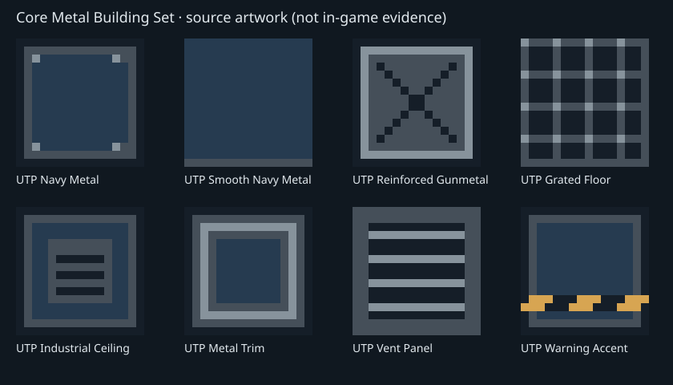

# Underground Tech Pack — M2 prototype build 0.1.2

A free, original, decorative building kit for underground technology rooms. The core metal set contains **eight full-cube blocks** for walls, floors, ceilings, borders, and ventilation details. The M2 prototype adds a straight pipe and a 90-degree elbow. See the [prototype device checklist](tests/m2-prototype.md). Android acceptance and screenshots are pending for both milestones.

[Roadmap](https://docs.google.com/document/d/1CPZ1EgoX2-QF5DlEAsDjBctHagWDV2a0npEUHUG3n9c/edit) · [M1 brief](https://docs.google.com/document/d/1oQAWaeWqeAK0ZclwmW7eTkEYGM6KrrjGK0w_q7U8DEA/edit) · [Issue #3](https://github.com/steelwater/steelwater-minecraft/issues/3) · [Asset catalog](docs/assets.md) · [Conventions](docs/conventions.md) · [Validation](tests/m1-validation.md) · [Lab](../../worlds/underground-tech-pack-lab/README.md) · [Changelog](../../CHANGELOG.md)



## Build and verify

From the repository root, using Python 3.12+ with no third-party dependencies:

```sh
python3 tools/utp.py render
python3 tools/utp.py validate
python3 -m unittest discover -s tests -v
python3 tools/utp.py build
```

`dist/underground-tech-pack-0.1.2.mcaddon` contains the player behavior/resource packs. `dist/underground-tech-pack-0.1.2-dev.mcaddon` adds the optional lab setup pack. Player packs are identical in both downloads. Checksums are in `dist/SHA256SUMS`; generated packages are ignored by Git. The unreleased 0.1.2 build is for testing the first two pipe models before the rest of the v0.2 set is built.

Editable 16×16 `.pixels` files and the palette live in `art/`. Run `render` after editing them; PNGs and the two SVG sheets must match their sources. The original `navy_metal` definition, artwork, and identifier are retained.

## Android import and placement

1. Record device, OS, Minecraft version and graphics mode. The existing format/minimum remains **1.21.80**; that is a technical baseline, not an M1 compatibility result. The prior owner-confirmed test target was **1.26.52.3**.
2. Import the development bundle with Minecraft. If Android has no file handler, use the [launcher](../../tools/android-addon-launcher/README.md), freshly built from the current source. The old v0.1.0 prerelease does not contain the lifecycle fix.
3. Create a **new dedicated Creative/Flat/Peaceful world**, enable cheats and coordinates, leave experiments off, and activate the main behavior/resource packs plus the optional lab setup pack.
4. Search Construction for **UTP**. All ten names appear in the [catalog](docs/assets.md). For example: `/give @s steelwater_utp:vent_panel 64`.
5. Follow the [M1 lab setup](../../worlds/underground-tech-pack-lab/README.md#milestone-1-station) and complete the [acceptance checklist](tests/m1-validation.md).

The eight core metal pieces are solid one-metre cubes with the same texture on each face. Trim is a framed border block, not a slab; vents and grates are opaque surface designs, with no holes, animation, airflow or rotation controls. No recipes, scripts, powered devices, screens or furniture are included.

## Status and rollback

Milestone 0 Android acceptance was [reported by Dan](tests/validation.md); it does not verify the expanded M1 pack. Use a new test world and preserve any existing world with its matching packs before importing an update. Stable UUIDs mean Minecraft treats these as updates to the same packs. Previous source remains in Git; do not downgrade a world containing new block IDs. No merge, release, deployment or production-world change is authorized by this implementation.
