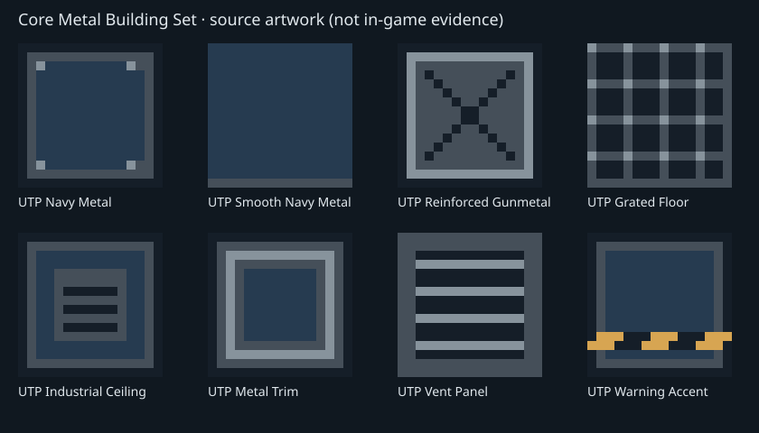

# Core Metal Building Set

Eight original 16×16 textures share the existing navy/gunmetal/steel/trim palette. Amber is limited to two pixel rows on the warning accent. All are opaque full cubes, use metal sound, and appear in Creative Construction. They share full collision/selection and ordinary place/break behavior. No directional states or experiments are needed.

Every identifier begins with `steelwater_utp:`. Filenames use the identifier suffix; atlas keys begin with `steelwater_utp_`.

| Identifier suffix | Inventory name | Intended use |
| --- | --- | --- |
| `navy_metal` | UTP Navy Metal | Original M0 riveted navy panel, preserved unchanged |
| `smooth_navy_metal` | UTP Smooth Navy Metal | Broad navy wall/structural surface with a fine edge seam |
| `reinforced_panel` | UTP Reinforced Gunmetal | Steel-framed gunmetal reinforcement, dark diagonal bracing |
| `grated_floor` | UTP Grated Floor | Repeating opaque grid; solid walking surface |
| `ceiling_panel` | UTP Industrial Ceiling | Recessed-looking frame and central ribs, visible underneath |
| `metal_trim` | UTP Metal Trim | Concentric steel/gunmetal border for room edges; full block |
| `vent_panel` | UTP Vent Panel | Framed horizontal intake slots for walls/ceilings; decorative |
| `hazard_panel` | UTP Warning Accent | Navy panel with a restrained amber caution band |

The same texture covers all six faces. Placement direction does not change geometry or face mapping; horizontal vent ribs stay horizontal on vertical faces. This deliberately avoids custom geometry and directional-state complexity for M1. Inspect overhead faces and repeated seams in actual Minecraft before accepting the visual result. The warning stripe is an accent, not a functional safety marker.

## Source and provenance

Each `.pixels` file in `art/` is a sixteen-row grid: `N` navy, `G` gunmetal, `S` dull steel, `T` dark trim, `A` amber. `palette.json` defines colors. `tools/utp.py render` compiles PNGs and contact sheets deterministically using only the standard library. Source art was authored directly for this project; no third-party imagery, logos or reference textures were imported. See [originality rules](originality.md).

## M1 implementation decisions — 17 November 2026

Owner: Dan. Scope authority: [M1 brief](https://docs.google.com/document/d/1oQAWaeWqeAK0ZclwmW7eTkEYGM6KrrjGK0w_q7U8DEA/edit).

The brief prefers simple full cubes and permits the smallest reliable trim choice. This set uses full cubes throughout, including framed trim and vent blocks. Partial geometry or directional variants would add placement and collision checks without being essential to the first room. Reconsider only if owner playtesting shows these full-block forms cannot satisfy the room-building acceptance criteria.

The original riveted prototype remains `navy_metal`; the smooth surface gets a new identifier. This preserves existing worlds and supplies both requested materials without modifying the accepted baseline artwork.

Manifest header/module/dependency versions advance together to `[0, 1, 1]` for an importable M1 development update, retaining all six UUIDs and the engine baseline. This distinguishes the package from M0 while reserving roadmap v0.2 for structural blocks plus pipes. It is not a release/tag selection. Existing M0 packages remain untouched.

## Milestone 2 prototype

| Creative name | Identifier | Placement |
| --- | --- | --- |
| UTP Straight Pipe | `steelwater_utp:straight_pipe` | Place against a side face for a horizontal run perpendicular to that face. Use the top or underside for a vertical run. |
| UTP Elbow Pipe | `steelwater_utp:elbow_pipe` | Place against a side face and turn to choose a horizontal bend. Place on the top or underside for a vertical bend with a fixed horizontal arm in this prototype. |

Pipe ends use a centered 6×6 profile on the 16×16 block grid. Each open end reaches the boundary plane. The straight pipe's collar widens to eight pixels in the middle. The elbow uses one rectangular selection and collision box around both arms, which includes the inside corner. Inspect both placement and collision in Minecraft before reusing these choices for the remaining families. The Creative inventory entries use the block models and English names. [Prototype checks](../tests/m2-prototype.md)
